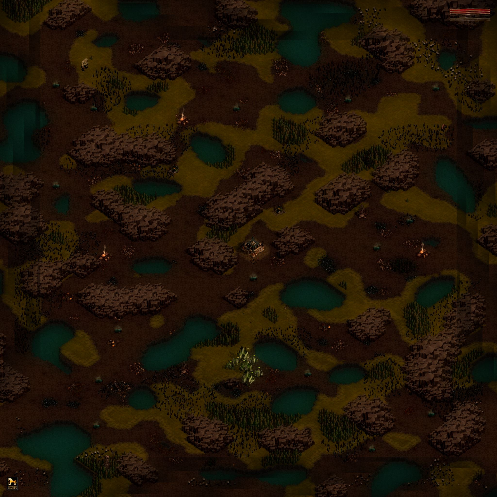
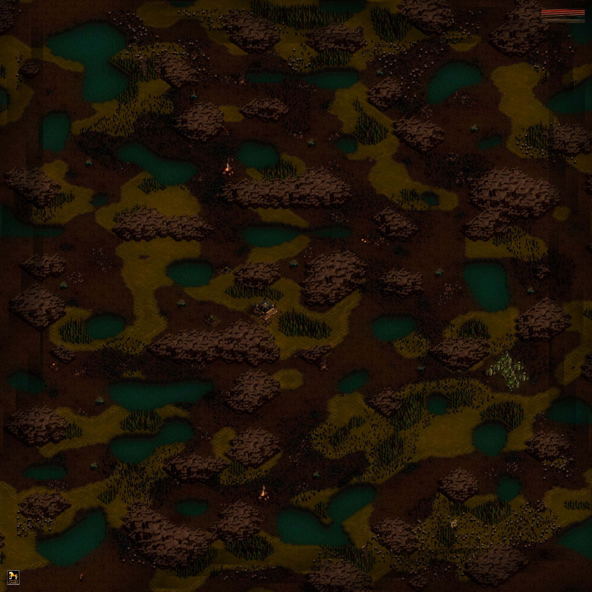
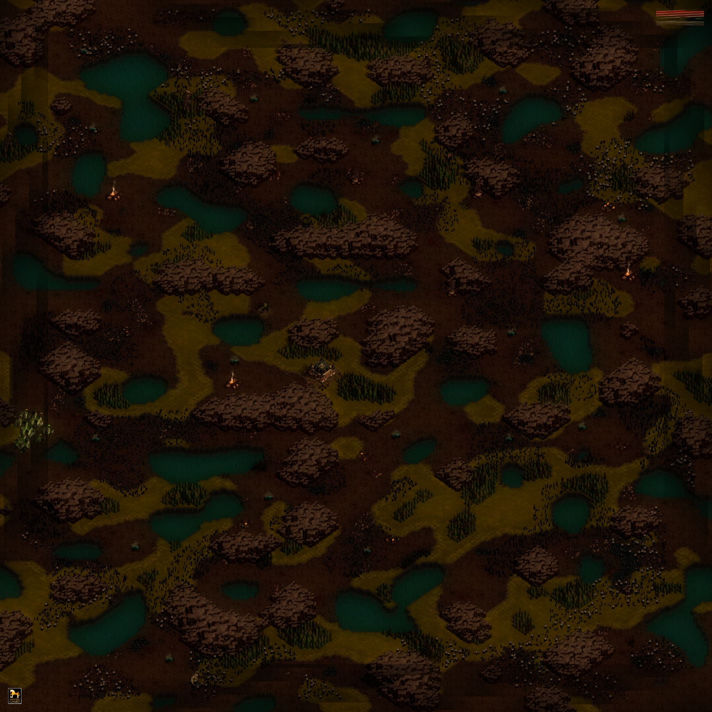
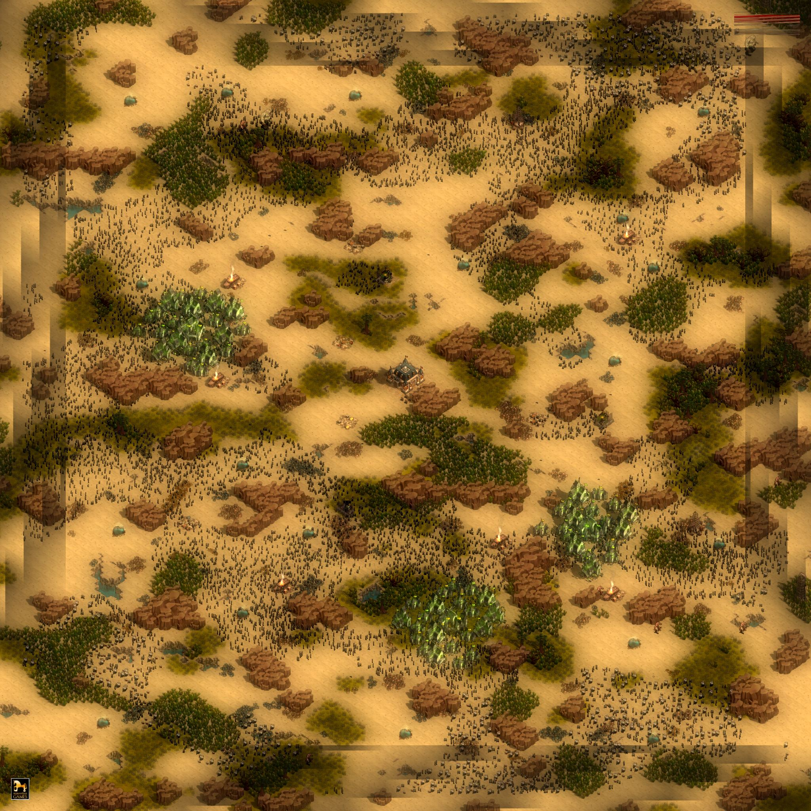
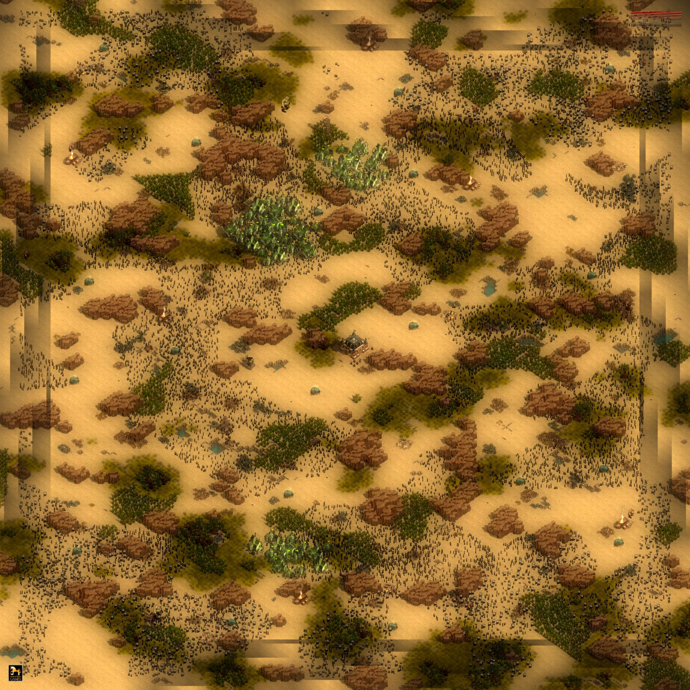
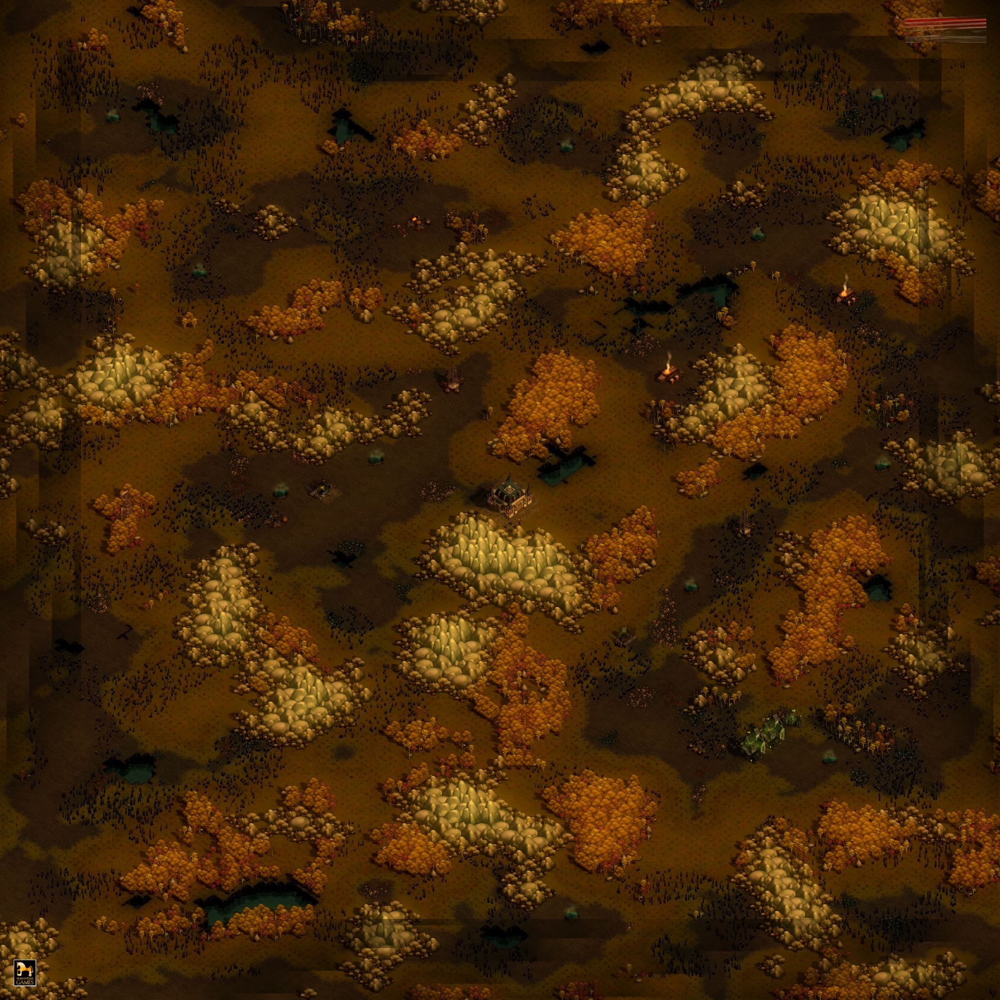
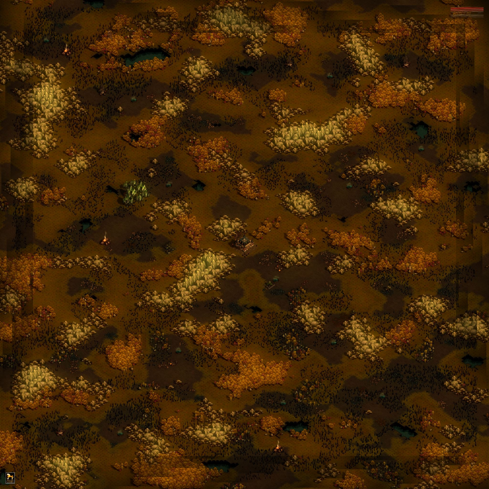
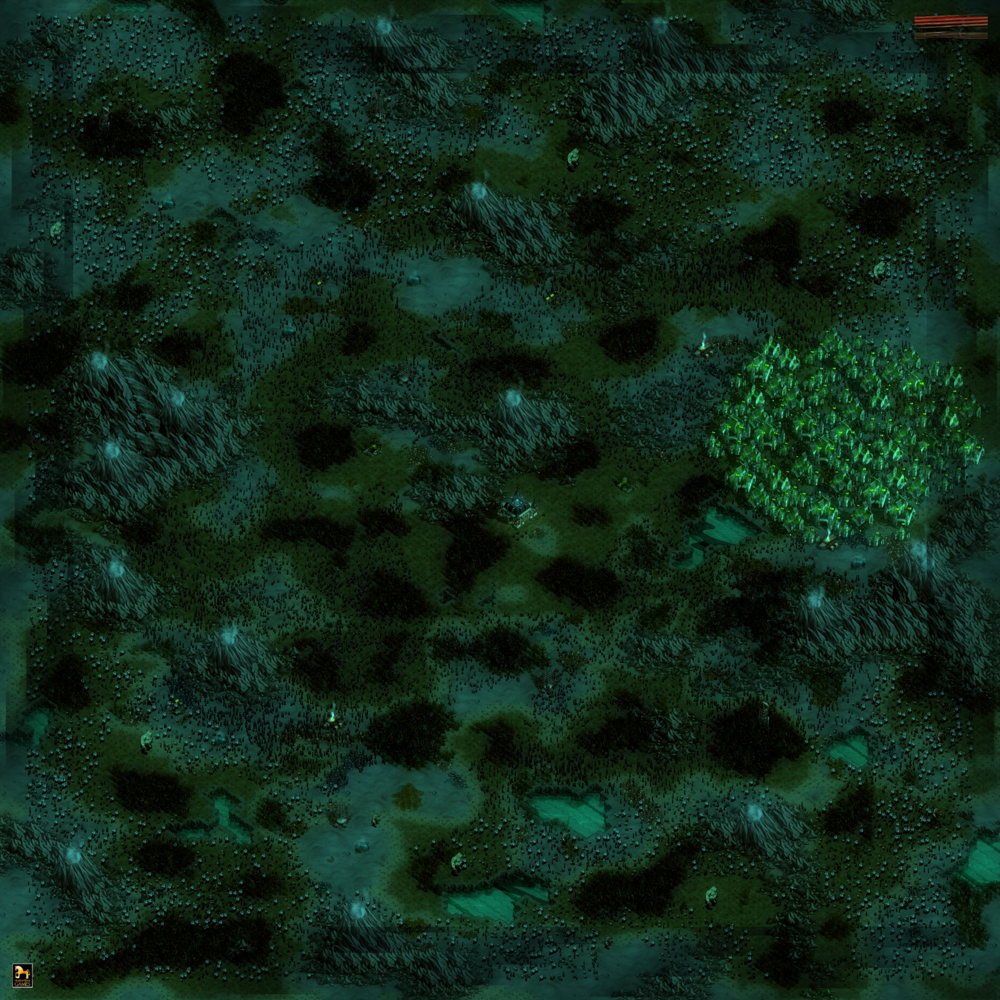
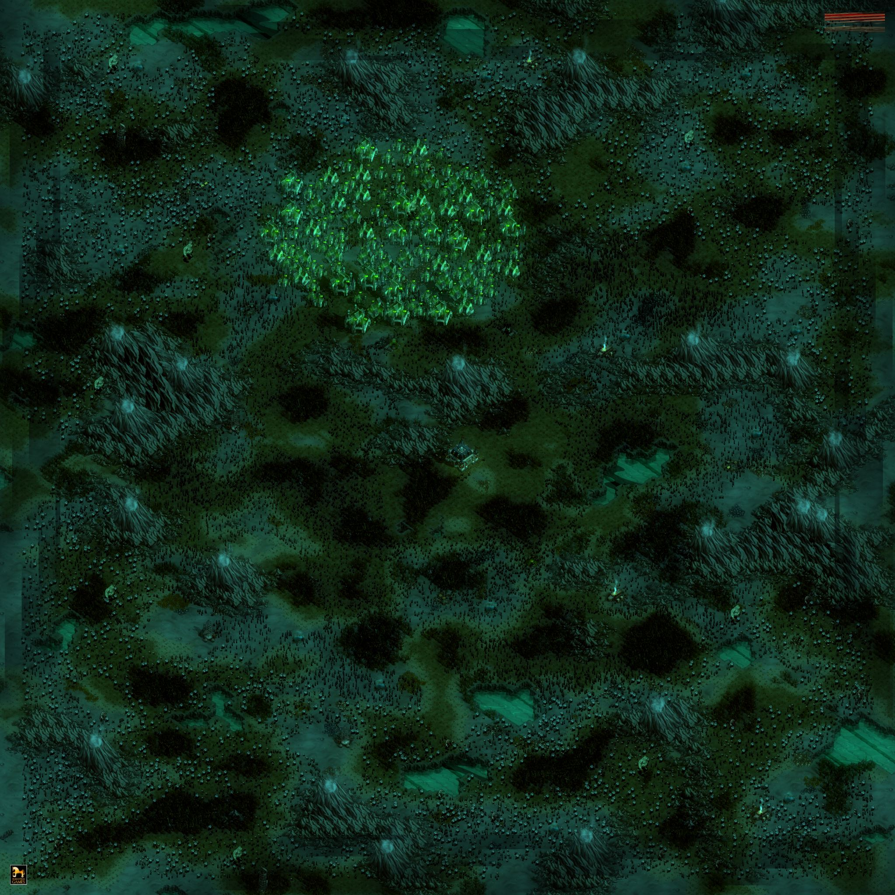

# TABCoopMod — 《亿万僵尸》(They Are Billions) 2~3 人 Steam P2P 合作联机 Mod

> **本仓库是 [`Negative12/TABCoopMod`](https://github.com/Negative12/TABCoopMod) 的 LAN 分支**，在 v0.1.5 基础上新增**原生局域网直连**（`CoopTransportMode.Lan`），详见 [`docs/13_LAN_MULTIPLAYER.md`](docs/13_LAN_MULTIPLAYER.md)。Steam P2P 与本地回环两条既有链路行为不变。发行版版本号 `v0.1.5-LAN`。

`TABCoopMod` 是为即时战略游戏《亿万僵尸》（They Are Billions, Steam x64 v1.0.14.29）打造的无服务器合作联机 Mod。通过 `.NET AppDomainManager` 运行时注入与 HarmonyX 内存补丁（不修改游戏 exe/dll 磁盘字节），支持 **2~3 名玩家** 基于 Steam P2P 大厅共同游玩生存模式、战役与自定义地图。

---

## 核心特性

### 执政官共控模式（Archon Mode，当前默认玩法）
- **同阵营共控，操作完全独立**：2~3 名玩家共同管理同一个人类基地、共享资源与科技，但每位玩家拥有**完全独立的摄像机视角、鼠标框选、编队热键与建造上下文**。
- **传统 RTS 等候大厅**：主菜单内置【多人合作模式】（快捷键 `K`），支持 Steam 好友房创建/邀请自动加入、**原生局域网直连（房间码即 IP，无需 Steam 登录与好友关系）**，以及 `127.0.0.1:27099` 本地双开测试；客机准备门控、房主复用原版【读取存档 / 新建生存游戏 / 自定义地图】界面及重返大厅功能。
- **协同交互体验**：
  - 小地图实时渲染队友彩色视野框（P1 蓝 / P2 绿 / P3 橙）。
  - `Alt + 左键` 地面与小地图同步战术信号打点（Ping）。
  - 空格或按钮同步冻结暂停（支持暂停期间微操），恢复时显示 3 秒顶居中倒计时。
  - 本地建造幽灵占位框、资源预扣防透支与 0ms 单位语音即时确认。
  - 市长二选一按 ID 确定性同步，杜绝双端重复领奖。
- **多人新生存局均衡预设**：房主可在大厅切换【联机均衡】与【原版】预设，针对 2P/3P 自动扩展生存地图尺寸（`280` / `304` 格）、初始巡逻兵力与指挥中心工人，并修正非 2 的幂次地图尺寸下的感染村镇/遗迹生成边界。
- **确定性同步与自愈**：30Hz 锁步状态哈希校验与 `Auto-resync` 自动快照重建恢复。

> 远期规划（Phase 4）：独立基地模式（多指挥中心生成、独立资源账本与单位所有权隔离）。

---

## 多人新生存局平衡性对比展示（4 场景同种子全景）

开启【联机均衡】预设后，模组会针对 2P / 3P 协同扩张效率自动扩图（`256 → 280 / 304`）、补充初始兵力与工人、按面积配平资源/游荡僵尸与波次强度，并修正非 2 的幂次地图尺寸下的感染村镇生成边界。

- **交互式全景对比报告**：[`reports/panorama_comparison.html`](reports/panorama_comparison.html)（下载或本地打开可缩放对比同种子全图与各项数值）
- **定量指标数据（JSON）**：[`reports/panorama_metrics.json`](reports/panorama_metrics.json)

| 场景 (`Seed`) | 档位 (`NCells` / 可玩宽) | 初始单位与额外工人 | 游荡僵尸总量 | 感染村镇建筑 | 巨人 / 变异体 |
| :--- | :--- | :---: | :---: | :---: | :---: |
| **BR 100% 暗黑荒原** (`202601`) | Vanilla `256` (`148`) | `4R + 1S` (`+0W`) | `5,198` | `7` | `1 / 1` |
| **BR 100% 暗黑荒原** (`202601`) | **2P `280` (`164`)** / **3P `304` (`178`)** | `6R + 1S` (`+2W`) / `6R + 2S` (`+3W, +1F`) | `9,849` / `11,485` | `7` / `7` | `1/1` / `1/1` |
| **DS 120% 干旱高地** (`202602`) | Vanilla `256` vs **2P `280`** | `4R + 1S` → `6R + 1S` (`+2W`) | `13,067` → `17,370` | `64` → `55` | `2/6` → `2/8` |
| **FA 120% 寒冰荒原** (`202603`) | Vanilla `256` vs **3P `304`** | `4R + 1S` → `6R + 2S` (`+3W, +1F`) | `9,769` → `17,448` | `3` → `7` | `0/0` → `0/0` |
| **VO 900% 剧毒荒原** (`202604`) | Vanilla `256` vs **2P `280`** / **3P `304`** | `6R + 1S` (`+2W`) / `6R + 2S` (`+3W, +1F`) | `15,652` → `22,295` / `25,952` | `81` → `95` / `115` | `6/12` → `6/15` / `9/18` |

<details>
<summary>展开查看 4 场景同种子全景对比图（Vanilla vs 2P / 3P）</summary>

### BR 100% Standard Survival (`Seed 202601`)
| Vanilla (`256`) | Co-op 2P (`280`) | Co-op 3P (`304`) |
| :---: | :---: | :---: |
|  |  |  |

### DS 120% Arid Highlands (`Seed 202602`)
| Vanilla (`256`) | Co-op 2P (`280`) |
| :---: | :---: |
|  |  |

### FA 120% Frozen Tundra (`Seed 202603`)
| Vanilla (`256`) | Co-op 3P (`304`) |
| :---: | :---: |
|  |  |

### VO 900% Caustic Nightmare (`Seed 202604`)
| Vanilla (`256`) | Co-op 2P (`280`) | Co-op 3P (`304`) |
| :---: | :---: | :---: |
|  |  |  |

</details>

---

## 玩家安装与联机指南

### 前置要求
- Steam 正版《They Are Billions》（**64 位版本 `TheyAreBillions.exe` v1.0.14.29**）
- 联机所有玩家需安装**完全相同的 Mod 版本**

### 安装步骤
1. 完全关闭游戏。
2. 在 Steam 中右键《They Are Billions》→ **管理** → **浏览本地文件**，打开游戏根目录。
3. **备份**游戏根目录中原有的 `TheyAreBillions.exe.config`（例如重命名为 `TheyAreBillions.exe.config.bak`）。
4. 将发行压缩包（如 `TABCoopMod-v0.1.0.zip`）中的所有文件**直接解压到游戏根目录**，提示替换 `TheyAreBillions.exe.config` 时选择覆盖。
5. 通过 Steam 正常启动游戏，主菜单出现【多人合作模式】即安装成功。

### 卸载步骤
1. 关闭游戏，删除根目录下的 `TABCoopMod.dll`、`TABCoopMod.pdb`、`0Harmony.dll`、`steam_appid.txt`、`TABCoopMod.log`、`TABCoopMod_Logs\` 与 `TABCoopMod_使用说明.txt`。
2. 还原之前备份的 `TheyAreBillions.exe.config.bak`（或通过 Steam "验证游戏文件的完整性"恢复原版配置）。

### 联机方式

主菜单按 `K` 进入【多人合作模式】等候大厅后，有三种连接方式：

| 方式 | 入口 | 需要 Steam 登录 | 需要互为好友 | 适用场景 |
| :--- | :--- | :---: | :---: | :--- |
| **局域网直连** | 【创建局域网房间】/【加入局域网房间…】 | 否 | 否 | 同一路由器下，或已组好的 Radmin / ZeroTier / Tailscale / 蒲公英 虚拟局域网 |
| Steam 好友 | 【创建 Steam 房间】/ 接受邀请 | 是 | 是 | 异地联机，Steam 大厅做信令 + UDP 直连 |
| 同机双开测试 | 【创建本地测试房间】/【加入本地房间】 | 否 | 否 | 单机验证，带延迟/抖动/丢包模拟 |

**局域网直连用法**：房主点【创建局域网房间】，按钮下方会显示本机 IP；客机点【加入局域网房间…】，在弹窗里填该 IP（`192.168.1.100` 或 `192.168.1.100:27099` 均可）。大厅顶部显示 `链路: LAN (ip:27099)` 即走局域网。

前置条件：

- 两台机器的 Mod 版本必须**完全一致**（握手会校验版本，不一致会弹窗提示）。
- 房主需放行 TCP 27099：

  ```powershell
  New-NetFirewallRule -DisplayName "They Are Billions LAN" `
    -Direction Inbound -Protocol TCP -LocalPort 27099 -Action Allow
  ```

- 多网卡机器（虚拟机 / VPN / Radmin）大厅会列出首选 IP，队友连不上时把括号里的其他网卡地址也试一遍。
- LAN 模式是**明文裸 TCP**，仅适用于可信局域网，不要在公共 / 不可信网络上使用。

> 详细技术说明见 [`docs/13_LAN_MULTIPLAYER.md`](docs/13_LAN_MULTIPLAYER.md)。

---

## 开发者构建与源码结构

### 环境要求
- Windows x64 + PowerShell
- .NET SDK（推荐 .NET 8/10 SDK，主 Mod 目标框架为 `net46` / `x64`，MCP 测试服务端为 `net10.0`）
- 本机已安装 Steam 版《They Are Billions》

### 初始化 SDK 引用与构建部署

> `scripts/extract_sdk.ps1` **必须用 Windows PowerShell 5.1 运行**（`powershell.exe`，不能用 `pwsh`）。PowerShell 7 基于 .NET Core，无法反射 .NET Framework 混淆程序集，会直接抛异常。
> 另外 `lib/` 必须位于**仓库根目录**——csproj 里的引用是 `..\..\lib\`，相对 csproj 上两级。

```powershell
# 1. 首次克隆后，从本机游戏主程序导出编译期只读引用库到 lib/（不会修改游戏文件）
powershell -NoProfile -ExecutionPolicy Bypass -File scripts/extract_sdk.ps1

# 2. 构建 Release 版本 Mod
dotnet build src/TABCoopMod/TABCoopMod.csproj -c Release

# 2'.（推荐）若用户目录不可写、或本机未安装 .NET Framework Reference Assemblies，
#     用封装脚本：它会重定向 TEMP/TMP/APPDATA/LOCALAPPDATA/DOTNET_CLI_HOME，
#     并校验产物里是否含 LAN 相关符号。
powershell -NoProfile -ExecutionPolicy Bypass -File scripts/build_lan.ps1

# 3. 打包面向玩家的纯解压发行压缩包（输出至 dist/）
powershell -NoProfile -ExecutionPolicy Bypass -File scripts/package_release.ps1

# （可选）开发机快速部署/卸载到本机游戏目录（部署前请确保游戏已关闭）
powershell -NoProfile -ExecutionPolicy Bypass -File scripts/install_mod.ps1
powershell -NoProfile -ExecutionPolicy Bypass -File scripts/uninstall_mod.ps1
```

> 脚本默认自动从 Steam 注册表与 `libraryfolders.vdf` 探测游戏安装路径，也可显式传入 `-GameDir "<路径>"` 或设置环境变量 `$env:TAB_GAME_DIR`。

**常见编译问题**

| 症状 | 原因 | 处理 |
| :--- | :--- | :--- |
| 324 个 `未能找到类型或命名空间名 "DXVision"...` | `lib/` 不在仓库根，MSBuild 静默跳过引用 | 把 `lib/` 放到仓库根；加 `-v normal` 可看到真因 `MSB3245` |
| `Access to the path '...\AppData\Local\Temp\<guid>' is denied` | 用户目录不可写 | 用 `build_lan.ps1`，或手动重定向 `TEMP`/`TMP`/`APPDATA`/`LOCALAPPDATA`/`DOTNET_CLI_HOME` |
| `MSB3644 未找到 .NETFramework,Version=v4.6 的引用程序集` | 本机缺 Reference Assemblies | csproj 已含 `Microsoft.NETFramework.ReferenceAssemblies` PackageReference |
| `restore` 长时间无输出 | 系统代理指向失效端口 | 清空 `HTTP_PROXY` / `HTTPS_PROXY` / `ALL_PROXY` |

### 目录结构

```text
TABCoopMod/
├── README.md                           # 项目简介、玩家安装与开发构建指南
├── docs/                               # 工程规范、架构设计、协议与验收报告
├── scripts/                            # SDK 提取、构建部署、打包与双开回归测试脚本
├── lib/                                # 本地提取的只读引用程序集（由 extract_sdk.ps1 生成，已 gitignore）
└── src/
    ├── TABCoopMod/                     # Mod 主工程 (.NET Framework 4.6, x64)
    └── TABCoopMod.Mcp/                 # 独立自动化控制/MCP stdio 服务端 (.NET 10)
```

---

## 技术文档索引

| 文档 | 内容说明 |
| :--- | :--- |
| [`docs/00_DEV_GUIDE.md`](docs/00_DEV_GUIDE.md) | 工程铁律、CLR / HarmonyX 踩坑手册与工具链规范 |
| [`docs/01_PRD_AND_GAMEPLAY.md`](docs/01_PRD_AND_GAMEPLAY.md) | 执政官模式玩法设计、状态划分与协同规则 |
| [`docs/02_ARCHITECTURE_DESIGN.md`](docs/02_ARCHITECTURE_DESIGN.md) | 注入机制、确定性沙盒、指令回放与内存快照流 |
| [`docs/03_REVERSE_ENGINEERING_MAP.md`](docs/03_REVERSE_ENGINEERING_MAP.md) | 逆向符号映射表与原生引擎行为说明 |
| [`docs/04_NETWORK_PROTOCOL.md`](docs/04_NETWORK_PROTOCOL.md) | 传输抽象、包头协议、`NetCommand` 与 `StateHasher` v2 |
| [`docs/05_DEVELOPMENT_ROADMAP.md`](docs/05_DEVELOPMENT_ROADMAP.md) | 分阶段里程碑与源码交付物清单 |
| [`docs/06_PROJECT_STATUS.md`](docs/06_PROJECT_STATUS.md) | 当前门禁实测状态与下一步待办 |
| [`docs/07_TESTING_AND_MCP.md`](docs/07_TESTING_AND_MCP.md) | 自动化回放验证、Chaos 故障注入与控制通道测试指南 |
| [`docs/08_RTS_SYNC_COMPARISON_AND_FUTURE_OPTIMIZATIONS.md`](docs/08_RTS_SYNC_COMPARISON_AND_FUTURE_OPTIMIZATIONS.md) | 经典 RTS 同步机制对比与后续优化评估 |
| [`docs/09_MULTIPLAYER_BALANCE_DESIGN.md`](docs/09_MULTIPLAYER_BALANCE_DESIGN.md) | 多人执政官生存新局平衡性设计与数值模型 |
| [`docs/10_STEAM_P2P_TEST_ANALYSIS_AND_OPTIMIZATION_PLAN.md`](docs/10_STEAM_P2P_TEST_ANALYSIS_AND_OPTIMIZATION_PLAN.md) | Steam P2P 链路实测、优化方案与网络兼容矩阵 |
| [`docs/11_SYNC_OWNERSHIP_AND_VISUAL_SMOOTHING.md`](docs/11_SYNC_OWNERSHIP_AND_VISUAL_SMOOTHING.md) | 同步所有权划分与视觉平滑 |
| [`docs/12_STEAM_P2P_BUGS_AND_FIXES_20261116.md`](docs/12_STEAM_P2P_BUGS_AND_FIXES_20261116.md) | Steam P2P 缺陷与修复记录 |
| [`docs/13_LAN_MULTIPLAYER.md`](docs/13_LAN_MULTIPLAYER.md) | **局域网原生联机**：改造动机、传输复用、逐处改动、取舍理由与已知限制 |
